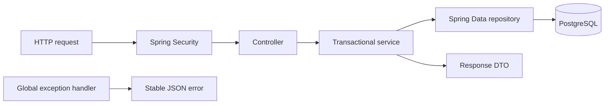
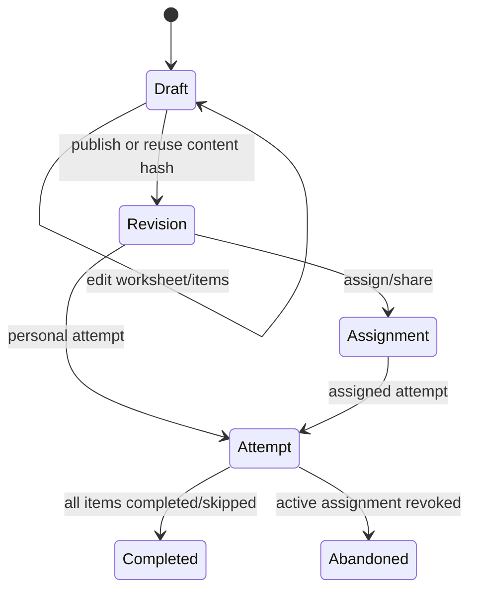

# Backend architecture

The backend is one Spring Boot 4.1 application organized as a feature-oriented modular
monolith. It uses Java 25, Spring MVC, Spring Security, Spring Data JPA, Flyway, Jackson
3, and NetworkNT JSON Schema validation.

## Request flow

- Controllers translate HTTP input/output and pass the authenticated identity onward.
- Services own authorization, lifecycle rules, validation, and transactions.
- Repositories contain persistence queries, including ownership-scoped lookups.
- Entities model persistence; response DTOs prevent accidental entity exposure.
- Shared infrastructure handles security, request IDs, errors, codes, and asset storage.

## Feature modules

| Package                   | Responsibility                                                             |
| ------------------------- | -------------------------------------------------------------------------- |
| `auth`                    | Accounts, roles, sessions, administrator bootstrap and user administration |
| `classroom`               | Teacher classrooms, memberships, child codes and public play entry         |
| `worksheet`               | Editable worksheet drafts, items, sharing and immutable revisions          |
| `assignment`              | Per-user worksheet assignments and teacher reports                         |
| `attempt`                 | Attempt lifecycle, frozen content, item outcomes and score aggregation     |
| `minigame`                | Versioned catalog definitions, JSON schemas and assets                     |
| `shared.security`         | Route authorization, CORS, CSRF and session policy                         |
| `shared.errors`           | Consistent error body, exception mapping and request IDs                   |
| `shared.storage`          | Replaceable mini-game asset storage interface and local implementation     |
| `minigame1`, `countmatch` | Compatibility adapters for legacy endpoints                                |

## Security model

The application uses one session system for `USER`, `TEACHER`, and `ADMIN` roles.

- Public routes are explicitly allow-listed.
- Spring Security performs authentication and coarse role checks.
- Services enforce owner/member/assignee access using the session user ID.
- Cross-user resource lookups return `404` to avoid revealing existence.
- Missing authentication returns `401`; wrong role returns `403`; lifecycle conflicts
  return `409`.
- Mutating requests require CSRF and browser CORS allows the configured origin with
  credentials.
- Login and signup rotate the session ID; logout invalidates the session.

Every API error includes a stable code, message, field errors, request ID, and timestamp.

## Worksheet lifecycle

`WorksheetRevisionService` snapshots the worksheet name, ordered items, definition
versions, configuration, and referenced assets. Identical content reuses the existing
content hash; changed content creates the next revision.

An attempt accepts idempotent per-item result updates only while `IN_PROGRESS`.
Completion checks that every revision item has `COMPLETED` or `SKIPPED`, then aggregates
total and maximum scores. Completed attempts are immutable.

## Catalog and assets

Mini-game definitions are keyed by stable type and positive version. Schemas validate
worksheet configuration and submitted results. Published definition contracts are not
edited in place; incompatible changes require a new version.

Asset uploads are checked by content bytes, size, media type, and SHA-256. Relational
links prevent deletion while an asset is referenced by a definition, draft item, or
revision item. `MiniGameAssetStorage` isolates persistence from the local-disk
implementation.

## Compatibility layer

Canonical new code uses `/api/attempts`. Existing worksheet-result, mini-game-result,
Minigame1, and Count & Match routes remain for compatibility. Do not build new features
on the legacy result pipeline.

## Verification

Fast tests use isolated H2 schemas. Maven `verify` also runs Flyway discovery,
PostgreSQL Testcontainers migration/upgrade checks, Hibernate schema validation, and
HTTP integration coverage. See [the backend reference](../backend/README.md) for exact
routes, authorization rules, configuration, and migration history.
