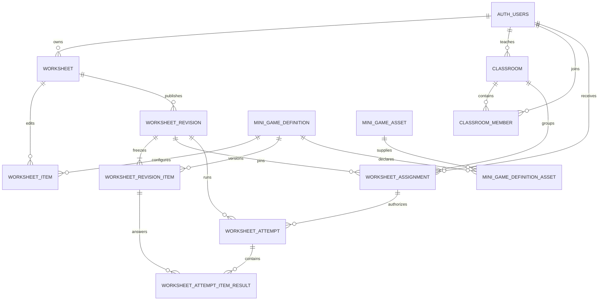

# Database architecture

PostgreSQL is the durable source of truth. Flyway owns its schema and Hibernate runs in
`validate` mode; application startup fails when mappings and migrations disagree.

## Canonical relationship model

## Table groups

| Area       | Tables                                                 | Key rule                                                         |
| ---------- | ------------------------------------------------------ | ---------------------------------------------------------------- |
| Identity   | `auth_users`                                           | Unique account identity and `USER`/`TEACHER`/`ADMIN` role        |
| Classroom  | `classroom`, `classroom_member`                        | Teacher ownership; membership history uses `left_at`             |
| Drafts     | `worksheet`, `worksheet_item`                          | Editable content owned once at worksheet level                   |
| Revisions  | `worksheet_revision`, `worksheet_revision_item`        | Unique revision number/content hash per worksheet                |
| Assignment | `worksheet_assignment`                                 | One frozen revision assigned to one user; revocation is retained |
| Attempts   | `worksheet_attempt`, `worksheet_attempt_item_result`   | Explicit state, bounded scores and one result per revision item  |
| Catalog    | `mini_game_definition`, `mini_game_asset`, link tables | Versioned JSON contracts and protected asset references          |

The V16 migration copied historical `worksheet_result` and `mini_game_result` rows into
the canonical attempt tables while preserving IDs and scores. The old tables remain for
compatibility routes; new development should use attempts.

## Ownership and access paths

- Draft access: `worksheet.user_id`.
- Item access: item → worksheet → owner.
- Classroom access: classroom → teacher or active member.
- Assignment access: assignment → assigned user; teacher access is derived through the
  pinned revision → worksheet owner.
- Personal attempt access: attempt → revision → worksheet owner.
- Assigned attempt access: attempt → assignment → assigned user or owning teacher.
- Item-result access: result → attempt; no duplicate user ID is stored.

This parent-derived model avoids contradictory ownership columns on child tables.

## Integrity rules

- Foreign keys preserve domain relationships; draft and revision children cascade only
  where their lifecycle permits it.
- Partial indexes accelerate active membership and assignment queries.
- Checks restrict roles, statuses, non-negative time/scores, `score <= max_score`,
  positive versions, and non-negative item order.
- Unique constraints protect emails, join/share/student codes, ordered items, definition
  type/version, revision numbers/hashes, and per-attempt item results.
- Referenced assets use restrictive deletion.
- Optimistic-lock columns protect editable worksheets and classrooms.

## Migration policy

Migrations live in `backend/src/main/resources/db/migration/`; Java migrations live in
`backend/src/main/java/db/migration/`. The current sequence includes SQL V1–V22 and Java
V23.

1. Add the next unused version; inspect both migration locations first.
2. Never rewrite an applied migration.
3. Make upgrades preserve existing rows and history.
4. Test both a fresh database and populated upgrades.
5. Investigate Flyway history errors before considering repair.

PostgreSQL integration tests use disposable Testcontainers databases and verify Flyway
plus Hibernate validation. Local development data is stored under
`database/postgres-data/` and must not be committed.
