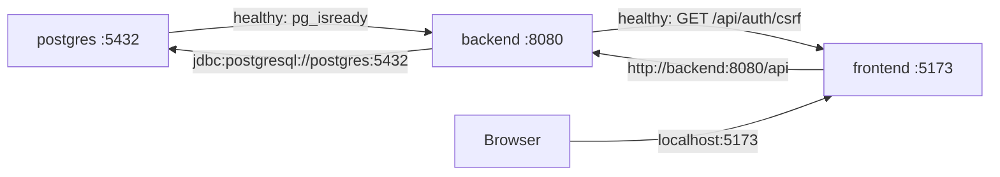

# Docker architecture

Docker Compose provides the local frontend, backend, and PostgreSQL environment.

## Services and startup order



Compose waits for PostgreSQL before starting the backend and waits for the backend
before starting the frontend.

## Ports and names

| Service    | Docker network address | Host address     |
| ---------- | ---------------------- | ---------------- |
| `frontend` | `frontend:5173`        | `127.0.0.1:5173` |
| `backend`  | `backend:8080`         | `127.0.0.1:8080` |
| `postgres` | `postgres:5432`        | `127.0.0.1:5433` |

Containers use service names and container ports. Browsers and host database tools use
the host addresses. Bindings are restricted to loopback for local development.

## Images

- Frontend: Node 24 Bookworm Slim; installs the lockfile and starts Vite on `0.0.0.0`.
- Backend build stage: Temurin JDK 25 and the Maven wrapper.
- Backend runtime: Temurin JRE 25 containing the packaged Spring Boot JAR.
- Database: official PostgreSQL 18 image.

The backend uses a multi-stage build so Maven and source files are not copied into the
runtime image.

## Storage

| Mount                                          | Type         | Purpose                            |
| ---------------------------------------------- | ------------ | ---------------------------------- |
| `./my-react:/app`                              | Bind mount   | Live frontend source updates       |
| `frontend-node-modules:/app/node_modules`      | Named volume | Container-owned npm dependencies   |
| `./backend/data:/app/data`                     | Bind mount   | Uploaded and mini-game asset files |
| `./database/postgres-data:/var/lib/postgresql` | Bind mount   | Persistent local database          |

`docker compose down` stops containers without removing bind-mounted data. Do not delete
the database or backend data directories as a routine reset.

## Configuration passed by Compose

The frontend receives `API_PROXY_TARGET=http://backend:8080` and polling for Windows
bind mounts. The backend receives the internal PostgreSQL URL, development credentials,
and allowed browser origin. Spring Boot still reads secrets and deployment-specific
values from environment variables.

## Development lifecycle

```powershell
# Initial/full build
docker compose up --build -d

# Rebuild Java application image
docker compose up --build -d backend

# Refresh npm dependencies
docker compose restart frontend

# Inspect state and logs
docker compose ps
docker compose logs -f frontend backend postgres

# Stop
docker compose down
```

Frontend source is mounted and handled by Vite hot updates. Backend source is copied at
image build time, so Java changes require a backend rebuild.

## CI and Testcontainers

The GitHub Actions Docker smoke job builds this Compose stack, waits for health checks,
then runs Playwright against `127.0.0.1:5173`. It uses a unique Compose project name and
removes containers and volumes afterward.

Backend integration tests are different: Testcontainers creates isolated temporary
PostgreSQL containers during Maven `verify`. They do not use the development database or
its persisted files.

## Production boundary

The Compose file is a development topology, not a production deployment definition.
Production must provide managed secrets, HTTPS/secure cookies, backups, durable asset
storage, observability, and an explicit frontend/backend delivery strategy. Development
credentials and bind mounts must not be copied into production.
