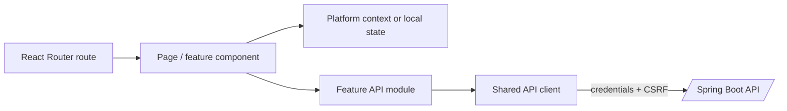

# Frontend architecture

The frontend is a React 19 single-page application built by Vite 8. It uses React
Router, Ant Design, Tailwind CSS, and feature-specific CSS.

## Request and state flow

- `main.jsx` mounts the application and router.
- `App.jsx` defines public, authenticated, and teacher-only routes.
- `PlatformProvider` owns session state and Romanian/English language selection.
- Page and worksheet components own feature-level UI state.
- `api/client.js` is the single transport boundary for JSON errors, cookies, CSRF, and
  expired-session events.

## Source map

| Path                       | Responsibility                                                       |
| -------------------------- | -------------------------------------------------------------------- |
| `src/api/`                 | Shared HTTP client and feature API functions                         |
| `src/Auth/`                | Login and signup screens                                             |
| `src/platform/`            | Session-aware pages, assignments, attempts, reports and translations |
| `src/Home/`                | Classroom, child and test views                                      |
| `src/WorkSheet/`           | Worksheet editor, activity list, player shell and mini-games         |
| `src/WorkSheet/minigames/` | Concrete mini-game renderers and editors                             |
| `src/Leftsidebar/`         | Authenticated navigation shell                                       |
| `src/components/ui/`       | Reusable UI primitives                                               |
| `src/lib/`                 | Sound, feedback, task-image and game helpers                         |

## Routing and access

`RequireSession` controls navigation for authenticated pages and supports teacher-only
routes. This is a user-experience guard only; every protected API operation is checked
again by Spring Security and the backend service.

The important route groups are:

- `/`, `/login`, `/signup`: public entry and account creation.
- `/home`, `/classes`, `/assignments`, `/account`: authenticated platform pages.
- `/sheets`, `/teacher/:worksheetId`: teacher worksheet management.
- `/attempts/:id`: user play flow or authenticated attempt view.
- Classroom child/test paths: teacher reporting views.

## API boundary

All new requests should use `apiRequest` or `send` from `src/api/client.js`.

- Cookies are sent with `credentials: "include"`.
- Non-read requests automatically fetch and send the CSRF token.
- Backend JSON errors become `ApiError` objects with status, code, field errors, and
  request ID.
- A protected `401` dispatches `session-expired`, allowing the platform context to
  clear stale session state.

Keep endpoint construction in `src/api/`; components should handle presentation and
interaction rather than duplicate fetch logic.

## Dynamic mini-games

The backend catalog supplies definition type/version, configuration schema, defaults,
result schema, and asset metadata. The frontend still needs a renderer/editor registered
for each supported `type`; catalog data alone cannot render arbitrary game behavior.

`src/platform/game-model.js` contains shared generation, scoring-payload, draft-save,
and configuration helpers. Concrete game UI lives under `src/WorkSheet/minigames/`.

When adding a mini-game:

1. Add or version its backend catalog definition and schemas.
2. Register its frontend type, title, editor, and player.
3. Keep frontend defaults and numeric bounds aligned with the backend schema.
4. Save results through the canonical attempt API.
5. Add save/reload, player, and result tests.

## Build and tests

- `npm test`: Node unit tests in `tests/`.
- `npm run lint`: ESLint checks.
- `npm run build`: production bundle written to Spring Boot static resources.
- `npm run test:e2e`: Playwright tests against the running stack.

Vite proxies `/api` to `API_PROXY_TARGET` and uses polling in Docker when
`VITE_USE_POLLING=true`.
