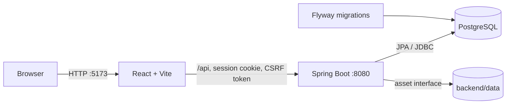

# System overview

Worksheet for kids is a browser application built as a React frontend, a Spring Boot
modular monolith, and a PostgreSQL database.

## Architecture documents

- [Frontend architecture](FRONTEND_ARCHITECTURE.md)
- [Backend architecture](BACKEND_ARCHITECTURE.md)
- [Database architecture](DATABASE_ARCHITECTURE.md)
- [Docker architecture](DOCKER_ARCHITECTURE.md)
- [Backend API and security reference](../backend/README.md)

## Runtime view



During Docker development, Vite proxies `/api` to the backend. A production frontend
build is written to `backend/src/main/resources/static`, where Spring Boot can serve it
with the API as one application.

## Main product flows

### Authentication

1. The frontend loads the current session from `GET /api/auth/me`.
2. Login or signup creates the `WORKSHEET_SESSION` cookie.
3. Mutating requests first obtain a CSRF token from `/api/auth/csrf`.
4. Spring Security verifies the session and route role; feature services verify resource
   ownership.

### Worksheet authoring

1. A teacher creates an editable worksheet draft.
2. Worksheet items reference versioned mini-game definitions and store validated JSON
   configuration.
3. The frontend chooses the matching editor/player through its mini-game type registry.
4. Sharing, assigning, or starting an attempt publishes or reuses an immutable revision.

### Assignment and play

1. A teacher owns a classroom and its memberships.
2. Assigning a worksheet creates one user assignment per selected member and pins one
   worksheet revision.
3. The assigned user starts an attempt against that revision.
4. Item results are saved while the attempt is in progress.
5. Completion validates every item and calculates totals on the backend.

### Historical integrity

```text
editable worksheet -> frozen revision -> assignment -> attempt -> item results
```

Edits affect the draft only. Existing assignments and attempts continue to use their
frozen revision, so historical content and scores keep the same meaning.

## Responsibilities

| Layer    | Owns                                                                         |
| -------- | ---------------------------------------------------------------------------- |
| Frontend | Routing, screens, editor/player interaction, local UI state and API calls    |
| Backend  | Authentication, authorization, validation, transactions and lifecycle rules  |
| Database | Durable relationships, constraints, indexes and migration history            |
| Docker   | Reproducible local processes, networking, health ordering and storage mounts |

The backend is the security boundary. Frontend role checks improve navigation but do
not grant access. PostgreSQL constraints protect structural integrity, while business
rules remain in backend services.
